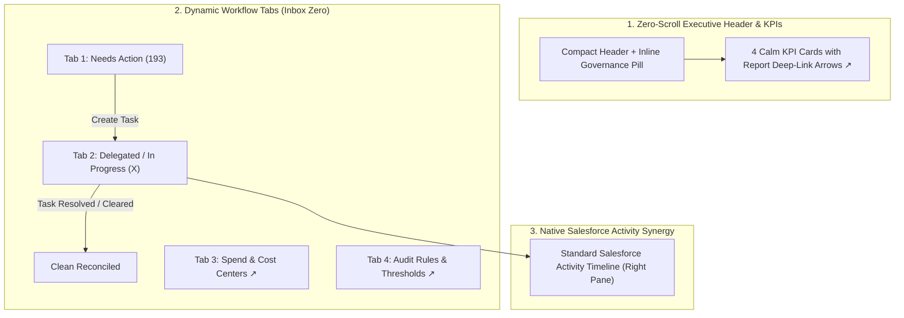
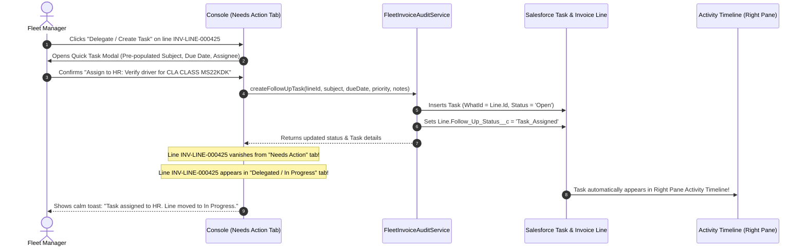

# Architectural Blueprint: Calm Executive Reconciliation Console & Dynamic Task Triage

**Document Reference:** `docs/plans/calm-executive-reconciliation-console.md`  
**Parent Session:** [`docs/sessions/2026-11-20-philips-pilot-ai-insights-thresholds-and-copilot-mcp.md`](file:///Users/elad.asulin/fleetforce-app/docs/sessions/2026-11-20-philips-pilot-ai-insights-thresholds-and-copilot-mcp.md)  
**Target User Persona:** Solo European Fleet Manager (High workload, limited time, needs cognitive calm and instant actionability).

---

## 1. Executive Summary & Design Critique

Based on the actual live screenshot review of the Stage 2 Option A build, several clear usability friction points emerge:

```
CURRENT (Vertical Cascade / High Cognitive Load):
┌─────────────────────────────────────────────────────────────────┐
│ Header & 4 Large Action Buttons                                 │
├─────────────────────────────────────────────────────────────────┤
│ Bill Reference & Subtitle                                       │
├─────────────────────────────────────────────────────────────────┤
│ 🚨 LARGE RED WARNING BANNER: "Governance Thresholds Breached"   │
├─────────────────────────────────────────────────────────────────┤
│ 🚨 HUGE CARD: Critical Blocker - Unallocated Spend Warning     │
├─────────────────────────────────────────────────────────────────┤
│ ⚠️ HUGE CARD: Warning - Operational Recharge Surge             │
├─────────────────────────────────────────────────────────────────┤
│ 4 Large KPI Cards (Pushed way below fold)                       │
├─────────────────────────────────────────────────────────────────┤
│ Tabset with 193 Exceptions (Extensive scrolling required)       │
└─────────────────────────────────────────────────────────────────┘
```

### Key Problems Identified:

1. **Vertical Pushing & Scroll Fatigue:** The two breached threshold cards consume over 280px of vertical space, pushing the 4 core KPI cards down and hiding the actual line items below the viewport fold.
2. **Alert Alarming vs. Calm Governance:** While threshold breaches are crucial, shouting at the user with multiple nested red/amber boxes creates anxiety rather than clarity. A single fleet manager needs a calm, measured summary with one-click drill-down.
3. **Passive Data Dead-End:** Once the fleet manager sees an unallocated vehicle (e.g. `MS22KDK` with £1,200 spend), they cannot do anything inside the tool other than mark it "Disputed" or "Clean". They cannot delegate it to HR or track follow-up.
4. **Empty Activity Timeline:** The standard Salesforce Activity Timeline on the right pane sits completely empty (_"No activities to show"_ in the screenshot), missing an opportunity for native platform synergy.

---

## 2. The "Calm & Organized" Console Philosophy

To respect the fleet manager's time and attention, the console will be restructured around three principles:



### Principle A: Compact 1-Screen Viewport

- **Condensed Alert Strip:** Replace stacked full-width cards with a sleek, 36px high-contrast **Governance Alert Pill** right in the header:
  `⚠️ 2 Threshold Breaches: 1 Critical Blocker (Unallocated Spend 13.4%), 1 Warning (Recharges 14.4%) [View Rules ↗]`
- Clicking the link switches directly to the **Audit Rules & Governance** tab without any scrolling.
- **KPI Cards Stay Above the Fold:** All 4 KPI cards remain immediately visible on standard laptop displays without scrolling.

### Principle B: Clickable Arrow Navigation (`↗`) on Insights & Reports

Every KPI and analytics block that is backed by a native Salesforce report or record will feature a discreet `utility:new_window` or chevron icon with a tooltip:

| Console Element             | Target Destination                                                                                                                                                                           | Navigation Mechanism                                |
| :-------------------------- | :------------------------------------------------------------------------------------------------------------------------------------------------------------------------------------------- | :-------------------------------------------------- |
| **Total Billed Gross KPI**  | [`Invoice_Spend_by_Category`](file:///Users/elad.asulin/fleetforce-app/force-app/main/default/reports/FleetForce_Financial_Reports/Invoice_Spend_by_Category.report-meta.xml) Report         | `standard__recordPage` (`Report`)                   |
| **Reconciled Clean KPI**    | [`Invoice_Reconciliation_Status`](file:///Users/elad.asulin/fleetforce-app/force-app/main/default/reports/FleetForce_Financial_Reports/Invoice_Reconciliation_Status.report-meta.xml) Report | `standard__recordPage` (`Report`)                   |
| **Unallocated Spend KPI**   | [`Invoice_Spend_by_Cost_Center`](file:///Users/elad.asulin/fleetforce-app/force-app/main/default/reports/FleetForce_Financial_Reports/Invoice_Spend_by_Cost_Center.report-meta.xml) Report   | `standard__recordPage` (`Report`)                   |
| **Recharges & Fines KPI**   | [`Invoice_Recharges_and_Fines`](file:///Users/elad.asulin/fleetforce-app/force-app/main/default/reports/FleetForce_Financial_Reports/Invoice_Recharges_and_Fines.report-meta.xml) Report     | `standard__recordPage` (`Report`)                   |
| **Threshold Breaches Pill** | **Tab 4 (Audit Rules)** within the LWC                                                                                                                                                       | Reactive Tab Switch                                 |
| **Threshold Rule Row**      | [`Fleet_Audit_Threshold__c`](file:///Users/elad.asulin/fleetforce-app/force-app/main/default/objects/Fleet_Audit_Threshold__c/Fleet_Audit_Threshold__c.object-meta.xml) Record               | `standard__recordPage` (`Fleet_Audit_Threshold__c`) |

---

## 3. Interactive Triage: The "Task Delegation & Queue Shifting" Workflow

The fleet manager is typically one person coordinating with multiple departments:

- **Unregistered vehicle?** Needs a query to the leasing company (Ayvens).
- **Unmapped driver / missing payroll ID?** Needs a query to HR/Payroll.
- **Over-threshold repair (>£5k)?** Needs sign-off from the Finance Director.

### The Queue-Shifting Lifecycle



### Visual Representation of the Tabs

1. **Tab 1: `Needs Action (${pendingCount})`**
   - Shows exceptions that have NOT yet been delegated or actioned.
   - Filter pills (Unregistered, Unmapped HR, Recharges, >£5k, Missing Credits, Disputed).
   - Action button on each row: **`[+ Delegate Task]`** or menu item.
2. **Tab 2: `Delegated / In Progress (${taskCount})`**
   - Shows items where a task has been created and is awaiting resolution.
   - Displays: Line #, Vehicle Plate, Amount, **Task Subject**, **Due Date**, **Assigned Role**, **Task Status**.
   - Clicking the Task Subject opens the standard Salesforce Task record.
   - Actions: `[Mark Resolved / Clean]`, `[Close Task]`.
3. **Tab 3: `Cost Center & Spend Analytics`**
   - Spend by category and top cost centers with clean click-to-open report arrows `↗`.
4. **Tab 4: `Audit Rules & Governance`**
   - Configurable threshold evaluation table (Limits, Actuals, Pass/Breached status, Notification targets).

---

## 4. Implementation Specifications

### A. Data Model Enhancements

To support state tracking without modifying standard Task schemas:

- Add `Follow_Up_Status__c` Picklist to `Fleet_Invoice_Line__c`:
  - Values: `None` (default), `Task_Assigned`, `In_Review`, `Resolved`.
- Add `Active_Task_Id__c` Text(18) or Lookup to `Fleet_Invoice_Line__c` for fast O(1) query joins.

### B. Apex Methods to Add (`FleetInvoiceAuditService.cls`)

1. `createFollowUpTask(Id lineId, String subject, Date dueDate, String priority, String description, String assignedToUserId)`:
   - Creates a standard `Task` linked to the line (`WhatId = lineId`).
   - Updates `Fleet_Invoice_Line__c.Follow_Up_Status__c = 'Task_Assigned'` and `Audit_Notes__c`.
   - Re-runs summary computation and returns updated DTO.
2. Extend `InvoiceAuditSummaryDTO`:
   - `pendingActionLines`: Lines where `Audit_Status__c != 'Clean'` AND `Follow_Up_Status__c != 'Task_Assigned'`.
   - `delegatedTaskLines`: Lines where `Follow_Up_Status__c == 'Task_Assigned'`.
   - `pendingActionCount`, `delegatedTaskCount`.
   - `reportIdMap`: Map of developer names to active report IDs for dynamic client navigation.

### C. LWC Enhancements (`fleetInvoiceAuditSummary`)

1. **Header Restructuring:**
   - Ultra-compact header with integrated governance alert banner.
2. **KPI Card Report Navigation:**
   - Add hoverable `utility:new_window` icon to each card header calling `NavigationMixin.Navigate` with the respective report ID.
3. **Delegation Modal (`lightning-modal` / inline dialog):**
   - Sleek dialog allowing the user to specify Task Subject, Due Date, Priority, and Notes with 1 click.
4. **Tab Restructuring:**
   - Four distinct tabs: `Needs Action`, `In Progress Tasks`, `Spend Analytics`, `Audit Governance`.

---

## 5. Summary of Benefits for the Fleet Manager

- **Zero Scrolling Required:** Key health metrics, KPIs, and the actionable queue are immediately visible above the fold.
- **Traceable Delegation:** The fleet manager transforms 193 daunting exceptions into tracked Salesforce tasks assigned to HR, Ayvens, or finance.
- **Instant Native Integration:** Tasks populate the native Activity Timeline on the right sidebar automatically.
- **Contextual Drill-Down:** Whenever executive questions arise, the manager clicks the little arrow `↗` on any card to open the fully aggregated Salesforce report.
